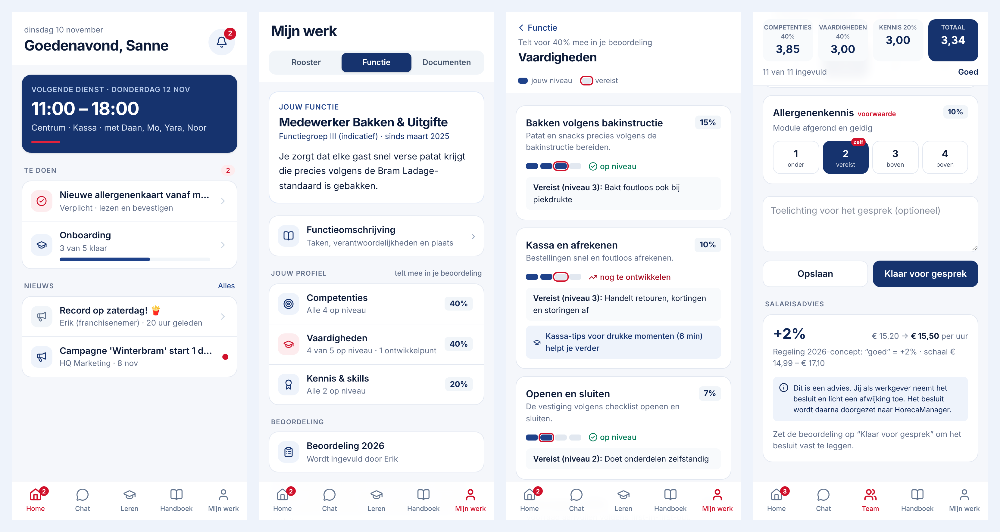

# Intradage

Het interne platform van Bram Ladage: één app voor nieuws, chat, leren, het handboek met AI-assistent, rooster en documenten, en een functiehuis met gewogen beoordelingen. Daarnaast een beheeromgeving voor HQ en franchisenemers.



> **Status: werkend prototype op PostgreSQL.** Alle schermen en flows werken en worden opgeslagen in de database. HorecaManager (Staff) is nog gesimuleerd achter een adapter.
>
> - Gebruik en live zetten: [docs/handleiding.md](docs/handleiding.md) (met screenshots)
> - Keuzes en het pad naar productie: [docs/architectuur.md](docs/architectuur.md)

## Starten

```bash
npm install
npm run dev          # http://localhost:3000
```

Op het startscherm kies je een persoon:

| Persoon | Rol | Laat zien |
|---|---|---|
| Sanne | Medewerker | Startscherm, verplicht bericht bevestigen, leren, handboek-assistent, rooster, functie en profiel, documenten met sms-code (demo: `123456`) |
| Yara | Shiftleider | Zelfde app, ander functieprofiel |
| Erik | Franchisenemer | Team, challenges beoordelen, ruil goedkeuren, beoordeling invullen met live salarisadvies, besluit vastleggen |
| Lisa | HQ Kwaliteit | Beheer: overzicht per franchisenemer, berichten met doelgroep en bereik |
| Joost | HQ HR | Beheer: functiehuis (wegingen), beloningsregeling, beoordelingen, logboek |

### Database

- **Lokaal** heb je niets nodig: zonder `DATABASE_URL` gebruikt de app PGlite, een volwaardige PostgreSQL die in het proces draait. De data staat in `.data/pglite`. Verwijder die map om opnieuw te beginnen.
- **Met een eigen PostgreSQL** zet je `DATABASE_URL=postgres://…`.
- Bij de eerste start voert de app de migraties uit (`drizzle/`) en laadt hij demodata als de database leeg is. Daarna kan HQ via **Logboek → Demodata herstellen** terug naar de beginstand.
- Pas je het schema aan (`src/lib/db/schema.ts`)? Maak dan een migratie met `npm run db:generate` en commit de nieuwe bestanden in `drizzle/`.

### Omgevingsvariabelen

| Variabele | Nodig | Doel |
|---|---|---|
| `DATABASE_URL` | productie | PostgreSQL-verbinding (op Railway: `${{Postgres.DATABASE_URL}}`) |
| `DATABASE_SSL` | soms | `true` bij een publieke database-URL met SSL |
| `DEMO_WACHTWOORD` | aanbevolen | Wachtwoord op het demo-inlogscherm |
| `ANTHROPIC_API_KEY` / `ANTHROPIC_MODEL` | nee | Taalmodel voor handboekantwoorden |
| `RAILPACK_NODE_VERSION` | Railway | `22` |

### Optioneel: AI-antwoorden

Zonder sleutel geeft de handboek-assistent een extractief antwoord: de best passende passage, met bron. Met een sleutel formuleert een taalmodel het antwoord, maar alleen op basis van die passages:

```bash
ANTHROPIC_API_KEY=... ANTHROPIC_MODEL=claude-sonnet-5-5 npm run dev
```

## Controleren

```bash
npm test             # unit tests + databasetests (PGlite, echte migraties)
npm run typecheck
npm run lint
npm run build && PORT=3100 npm start   # daarna in een tweede terminal:
npm run e2e          # end-to-end flows in headless Chrome (CHROME_PATH instelbaar)
```

## Structuur

```
src/
  app/
    page.tsx                 inloggen (demo: persoon kiezen)
    app/                     medewerker-app (mobiel): home, berichten, chat, leren,
                             handboek, werk (rooster/functie/documenten), team (FN/manager)
    beheer/                  beheeromgeving (desktop): overzicht, berichten,
                             beoordelingen, functiehuis, beloningsregeling, logboek
  components/                UI-bouwstenen (lijstrij, segmenten, niveau, formulieren)
  lib/
    types.ts                 domeinmodel
    access.ts                rechtenmodel: rol × scope × doelgroep
    acties.ts                alle schrijfacties (server actions), met rechtencheck en logboek
    data.ts                  leesfuncties (SQL via Drizzle), gefilterd per gebruiker
    org.ts                   organisatie/functiehuis per request in één keer geladen
    db/schema.ts             PostgreSQL-schema (25 tabellen, enums, constraints)
    db/client.ts             verbinding (pg of PGlite), migraties, seed bij lege database
    db/seed.ts               demodata
    staff/adapter.ts         HorecaManager-koppeling (nu: MockStaffAdapter)
    functiehuis/             functies, profielen, weging, beoordeling → salarisadvies
    handboek/                zoeken in passages + assistent met bronvermelding
drizzle/                     SQL-migraties
docs/
  handleiding.md             gebruik per rol + live zetten op Railway (met screenshots)
  architectuur.md            keuzes, productiepad, open punten
  functiehuis.md             rekenregels en spelregels van het functiehuis
  voorstel/                  het voorstel (PDF)
```

## Ontwerpprincipes

- **Blauw voor structuur, rood voor actie.** Rood alleen als iets aandacht of een handeling vraagt: verplicht bericht, te beoordelen, versturen.
- **Eén lijststijl, één kaartstijl.** Elk scherm bestaat uit secties met lijstrijen. Dat maakt het voorspelbaar voor een 16-jarige parttimer.
- **Eén hoofdactie per scherm**, onderaan en duidelijk.
- **Tikvlakken van minimaal 44 px.**
