# Handleiding Intradage

Voor medewerkers, franchisenemers en HQ. De opgemaakte versie staat in [handleiding-gebruikers.pdf](handleiding-gebruikers.pdf).

---

### 1. Inloggen

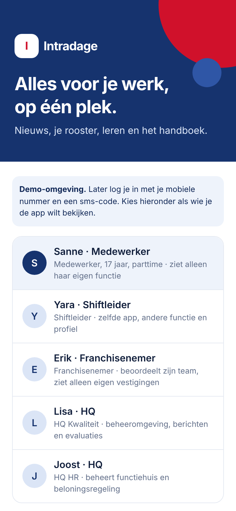

1. Open de link van de app.
2. Kies als wie je wilt inloggen. In de demo zijn dat vijf vaste personen.
3. Is er een demo-wachtwoord ingesteld (`DEMO_WACHTWOORD`), vul dat dan in.
4. Tik op **Inloggen**.

Medewerkers komen in de app terecht, HQ-gebruikers in de beheeromgeving.
Wissel van persoon via **Wissel persoon** bovenaan het scherm (op een groter scherm) of in de beheeromgeving.

> In de echte app log je in met je mobiele nummer en een sms-code. De rollen en rechten blijven hetzelfde.

 

### 2. Medewerker (Sanne)

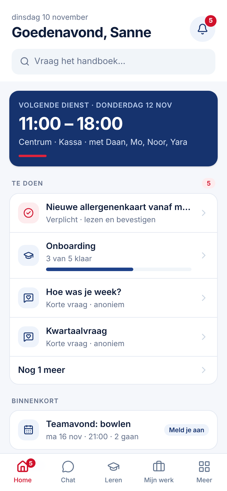

**Startscherm**

- Onderin staan vijf tabs: **Home**, **Chat**, **Leren** (voor leidinggevenden: **Team**), **Mijn werk** en **Meer**.
- Met de zoekbalk **Vraag het handboek…** stel je meteen een vraag aan het handboek.
- Daaronder staat je **volgende dienst**, met de collega's die met je werken.
- Onder **Te doen** staat wat aandacht vraagt: een verplicht bericht, je onboarding, een korte peiling of een actiepunt. Rood betekent dat je echt iets moet doen.
- Onder **Binnenkort** staat het eerstvolgende evenement. Daar kun je je meteen aanmelden.
- Met het belletje rechtsboven open je alle meldingen.

 

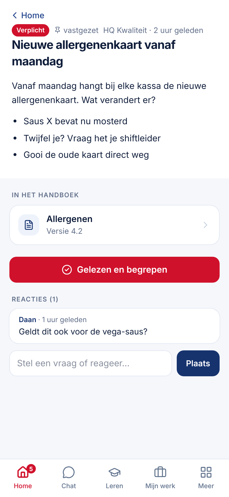

**Een verplicht bericht bevestigen**

1. Tik op het bericht onder *Te doen*.
2. Lees het en open zo nodig het gekoppelde handboekdocument.
3. Tik op **Gelezen en begrepen**. Het bericht verdwijnt uit *Te doen*, en HQ ziet dat je het hebt bevestigd.
4. Heb je een vraag? Stel die onder **Reacties**.

 

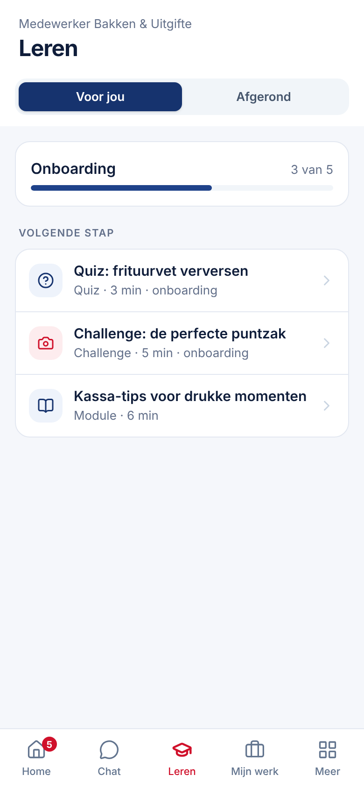

**Leren**

- Je ziet alleen leeritems die bij jouw functie horen.
- Bovenaan staat je onboarding met de voortgang.
- Een **challenge** dien je in met een foto. Je franchisenemer keurt hem goed of geeft feedback.
- Een **quiz** is afgerond zodra alle antwoorden goed zijn.

 

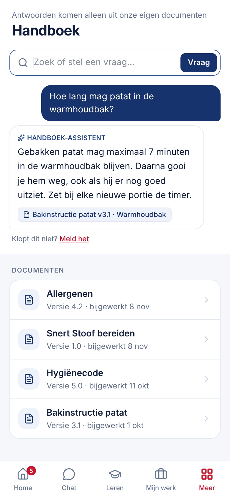

**Handboek en assistent** (via de zoekbalk op Home of *Meer › Handboek*)

1. Typ een vraag in gewone taal en tik op **Vraag**.
2. Het antwoord komt alleen uit de handboekdocumenten die jij mag zien. Onder het antwoord staat altijd de **bron**; tik erop om die passage te openen.
3. Staat het antwoord niet in het handboek, dan zegt de assistent dat eerlijk. HQ krijgt de vraag dan te zien, zodat het handboek kan worden aangevuld.
4. Klopt een antwoord niet? Tik op **Meld het**.

 

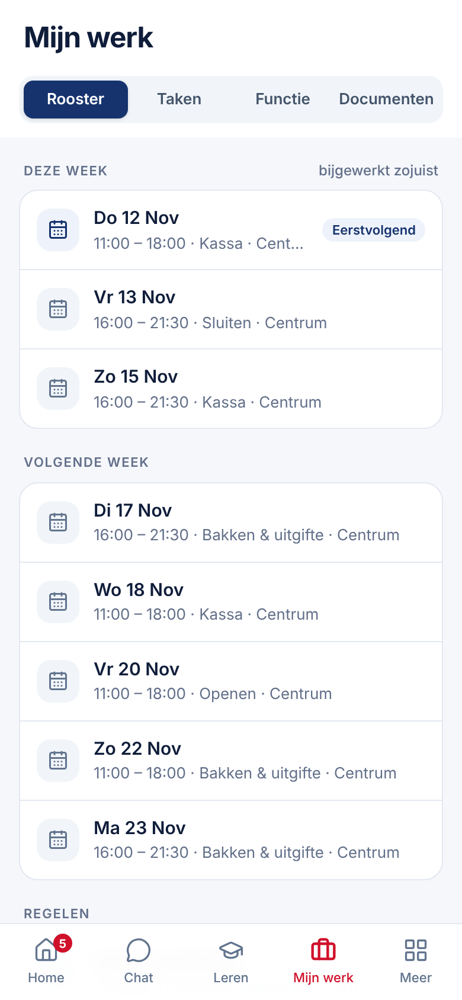

**Mijn werk: rooster**

- Je rooster komt uit HorecaManager.
- **Dienst aanbieden**: tik eerst daarop en kies dan de dienst. Collega's met dezelfde functie zien hem in de teamchat en kunnen hem overnemen. Je leidinggevende keurt de ruil goed.
- Beschikbaarheid en verlof regel je voorlopig in de Staff-app.

 

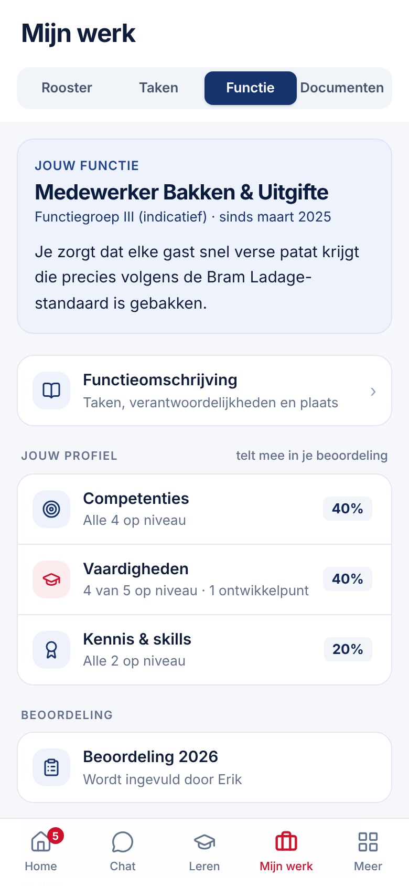

**Mijn werk: functie**

- Hier staat **jouw** functie, met de omschrijving. Functies van anderen zie je niet.
- **Jouw profiel** heeft drie onderdelen: competenties, vaardigheden en kennis & skills. Elk onderdeel heeft een **weging**; samen tellen ze op tot 100%.
- Bij **Beoordeling** zie je de stand van je beoordeling. Is een ronde gestart, dan vul je eerst je **zelfbeoordeling** in.

 

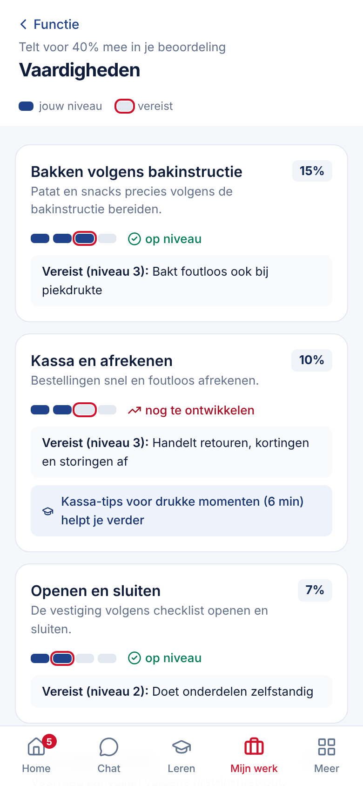

**Je profiel per onderdeel**

- De blauwe blokjes geven jouw niveau aan, de rode rand het vereiste niveau voor je functie.
- Onderdelen met een groene vink zitten op niveau. Bij een pijltje omhoog kun je nog groeien.
- Waar het kan, staat een leeritem dat je helpt het volgende niveau te halen.

 

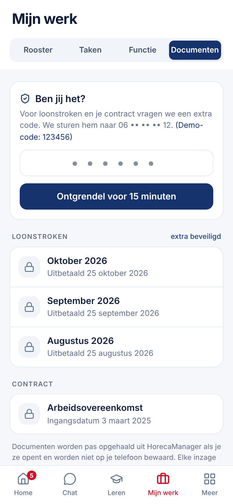

**Mijn werk: documenten**

1. Loonstroken en je contract zijn extra beveiligd.
2. Vul de code in die je per sms ontvangt (in de demo: `123456`).
3. Daarna kun je ze 15 minuten bekijken.

Documenten worden niet op je telefoon bewaard, en elke inzage komt in het logboek.

 

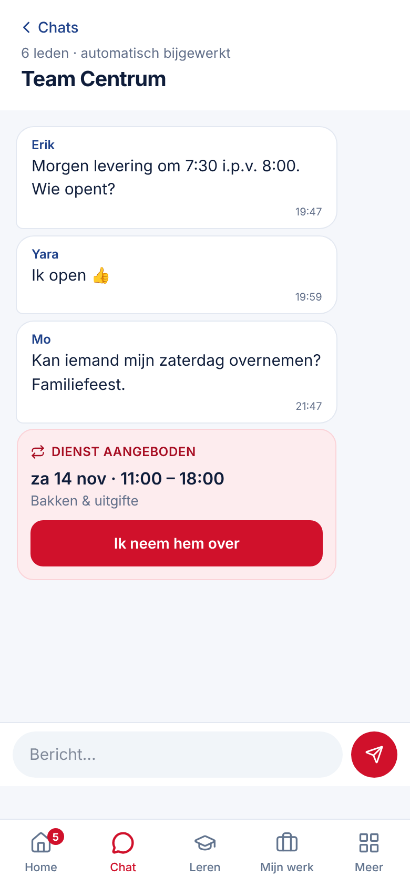

**Chat**

- Je zit automatisch in de groep van je vestiging en van je franchisenemer. Shiftleiders hebben daarnaast een eigen groep.
- Ga je uit dienst, dan verdwijn je automatisch uit alle groepen.
- Collega's zien nooit je telefoonnummer.
- Een aangeboden dienst neem je over met **Ik neem hem over**.

 

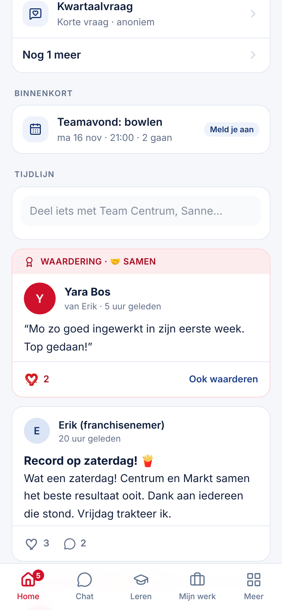

**Tijdlijn: posten, liken en reageren**

- Op de tijdlijn staan berichten van HQ en je franchisenemer, posts van collega's, waarderingen en **momenten**: verjaardagen, jubilea en nieuwe collega's.
- Wil je iets delen, zoals een foto van een drukke zaterdag? Tik op **Deel iets met …**, typ je bericht en tik op **Plaatsen**. Alleen je eigen team ziet het.
- Vind je iets leuk? Geef een **sausje**: tik op het ketchup-hartje. Tik nog een keer om het terug te nemen. Op het tekstballonnetje reageer je.
- Bij een verjaardag of jubileum tik je op **Feliciteer** om iemand te waarderen.
- Een eigen post kun je weer verwijderen. Je leidinggevende kan posts verwijderen die niet passen.

 

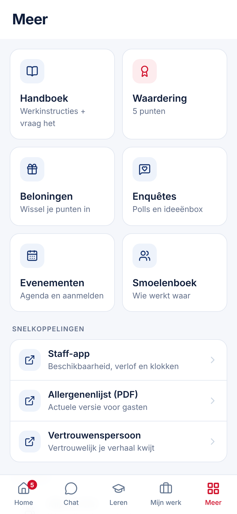

**Meer**

Onder **Meer** vind je alles wat je niet elke dienst nodig hebt: het **Handboek**, **Waardering**, **Beloningen**, **Enquêtes**, **Evenementen** en het **Smoelenboek**. Daaronder staan snelkoppelingen naar de Staff-app, de allergenenlijst en de vertrouwenspersoon, en je profiel.

 

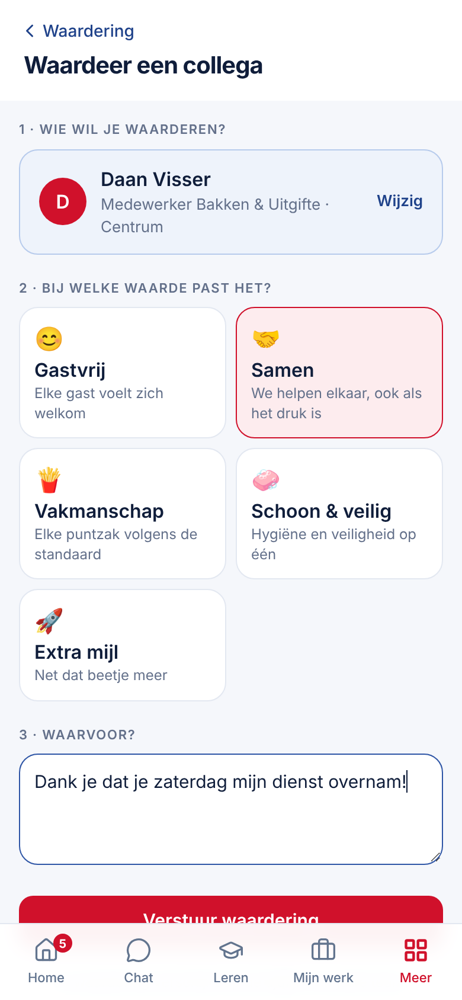

**Een collega waarderen**

1. Tik op **Meer › Waardering › Waardeer een collega**, of op **Waardeer** bij iemands profiel.
2. Kies de collega.
3. Kies de **kernwaarde** die erbij past, bijvoorbeeld *Gastvrij* of *Samen*.
4. Schrijf in één zin waarvoor je diegene waardeert en tik op **Verstuur waardering**.

Je waardering verschijnt op de tijdlijn van jullie team. Je collega krijgt er 10 punten voor, jij 2.

 

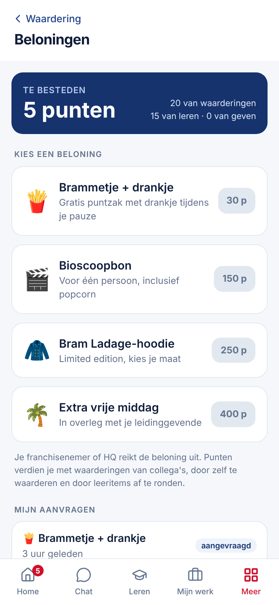

**Punten en beloningen**

- Je verdient punten als je gewaardeerd wordt (10), als je een ander waardeert (2) en als je een leeritem afrondt (5).
- Onder **Meer › Beloningen** zie je hoeveel punten je kunt besteden en wat je ervoor kunt krijgen.
- Tik op **Inwisselen**. Je franchisenemer of HQ reikt de beloning uit. Onder **Mijn aanvragen** zie je de status.
- Er is geen ranglijst van personen. Wel zie je welke teams deze maand het vaakst zijn gewaardeerd.

 

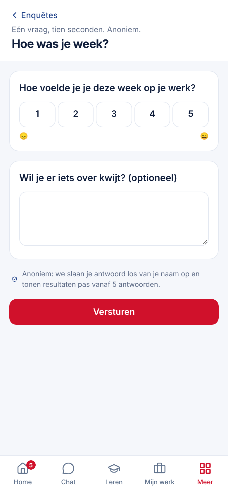

**Enquêtes, polls en ideeën**

- Een korte peiling staat vanzelf onder *Te doen*. Invullen kost een paar seconden.
- **Anoniem** betekent: je antwoord wordt los van je naam opgeslagen, en resultaten zijn pas zichtbaar vanaf 5 antwoorden. Zo is niemand herleidbaar.
- Bij een **poll** zie je na het stemmen meteen de uitslag.
- Heb je een idee om iets beter te doen? Stuur het in via de **Ideeënbox** onder *Meer › Enquêtes*.

 

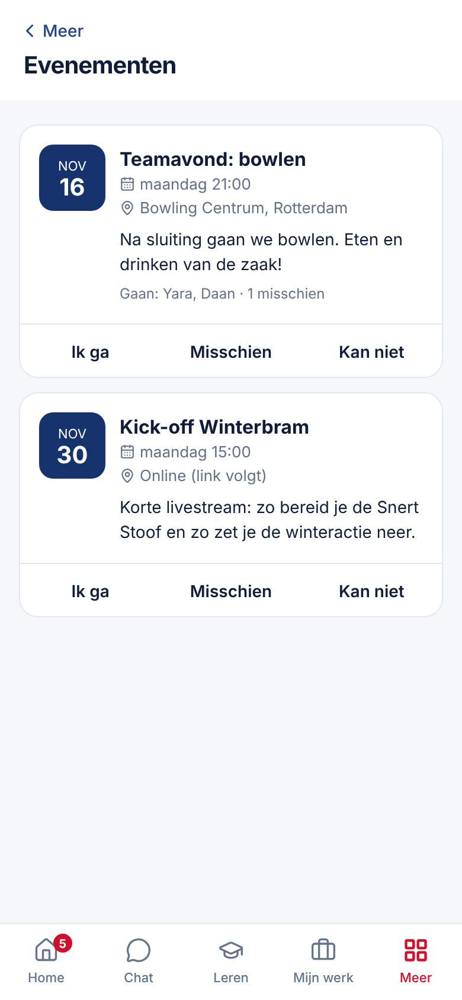

**Evenementen**

- Onder **Meer › Evenementen** staan teamavonden, trainingen en online sessies.
- Tik op **Ik ga**, **Misschien** of **Kan niet**. Je ziet ook wie er nog meer gaan.

 

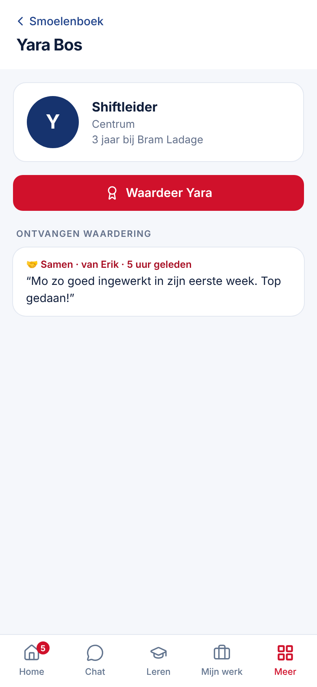

**Smoelenboek**

- Onder **Meer › Smoelenboek** zoek je collega's op naam, gesorteerd per vestiging.
- Op iemands profiel zie je de functie, vestiging en ontvangen waarderingen. Telefoonnummers worden nooit getoond.
- Op je **eigen** profiel vul je **Over mij** in en kies je of je verjaardag op de tijdlijn mag verschijnen.

 

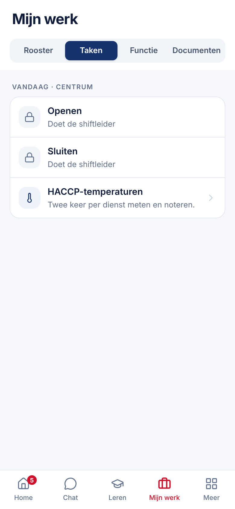

**Mijn werk: taken en checklists**

- Onder **Mijn werk › Taken** staan de checklists van vandaag voor jouw vestiging: **Openen**, **Sluiten** en **HACCP-temperaturen**.
- Groen betekent dat een checklist vandaag al is gedaan, en door wie.
- Met een slotje doet je shiftleider deze checklist. Temperaturen meten mag iedereen.
- Heb je een actiepunt toegewezen gekregen, dan staat het hier ook en in *Te doen*.

 

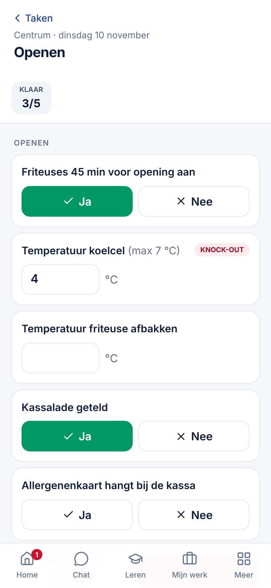

**Een checklist invullen** (shiftleider)

1. Tik op de checklist.
2. Beantwoord elke vraag met **Ja/Nee** of vul de gemeten waarde in.
3. Is een meting buiten de norm, zoals een koelcel boven 7 °C, dan kleurt de vraag rood. Schrijf erbij wat er aan de hand is en maak een foto.
4. Tik op **Afronden** zodra alles is ingevuld. Ben je nog niet klaar, tik dan op **Tussendoor opslaan**.

 

### 3. Franchisenemer (Erik)

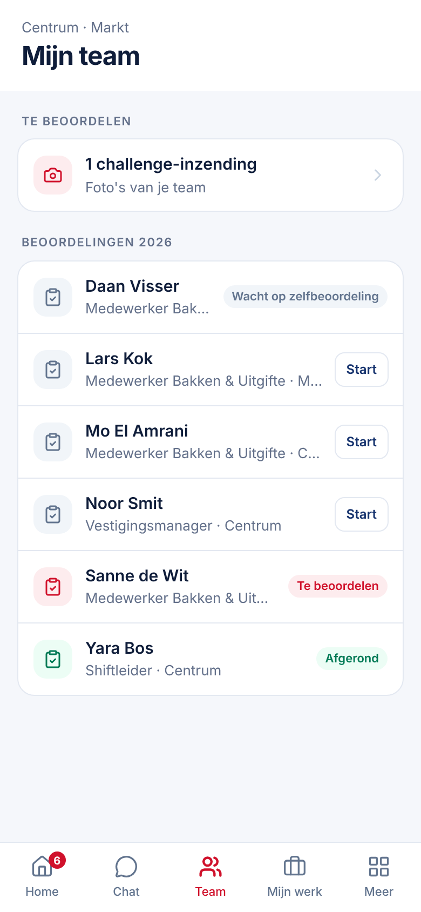

**Mijn team**

- Onder **Ruilverzoeken** keur je een ruil goed of af.
- Onder **Te beoordelen** staan de challenges die je team heeft ingediend.
- Onder **Beoordelingen 2026** zie je per medewerker de status. Met **Start** begin je een nieuwe ronde; de medewerker vult dan eerst een zelfbeoordeling in.

 

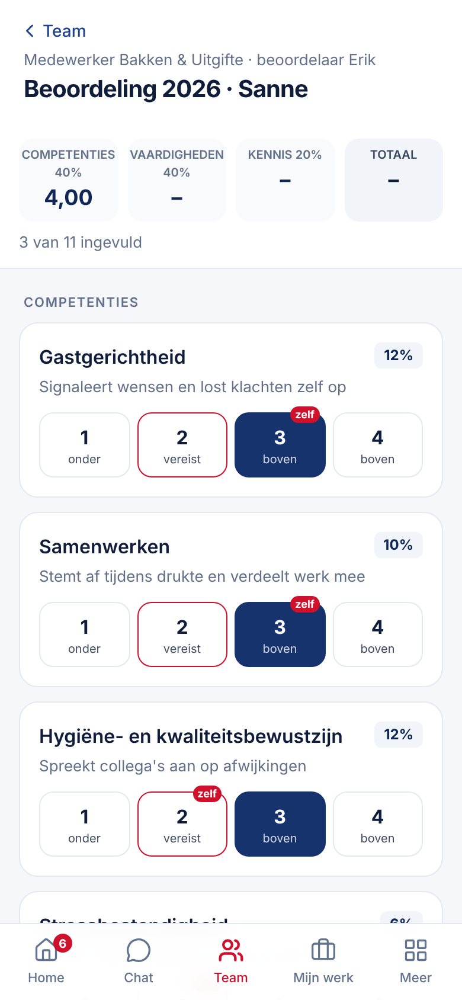

**Beoordelen**

1. Kies per onderdeel het niveau dat de medewerker laat zien (1–4). De rode rand geeft het vereiste niveau aan, het label **zelf** wat de medewerker zelf heeft ingevuld.
2. Bovenaan zie je direct de gewogen score per categorie en het totaal.
3. Tik op **Opslaan** om tussendoor op te slaan, en op **Klaar voor gesprek** als alles is ingevuld.

 

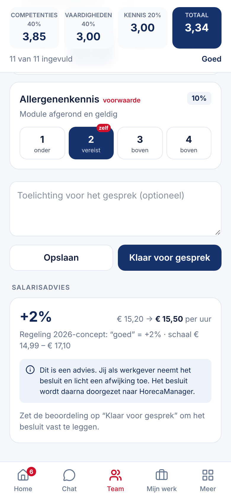

**Salarisadvies en besluit**

- De app geeft een **advies** volgens de beloningsregeling. Dat advies blijft altijd tussen het basis- en het eindloon van de functiegroep.
- Ontbreekt een verplicht certificaat, dan is de uitkomst begrensd.
- Na het gesprek leg **jij** het besluit vast. Wijk je af van het advies, dan vraagt de app om een korte toelichting.
- Het besluit komt in het logboek en wordt doorgezet naar HorecaManager.

 

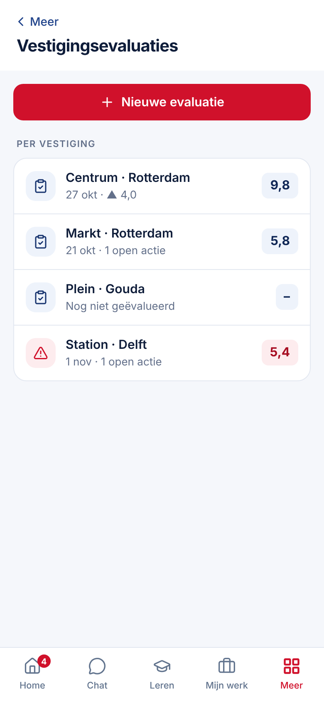

**Vestigingsevaluaties** (franchisenemer, manager en HQ)

- Onder **Meer › Evaluaties** zie je per vestiging het laatste cijfer, de trend sinds de vorige evaluatie en het aantal open actiepunten.
- Met **Nieuwe evaluatie** start je een evaluatie. Heb je meerdere vestigingen, kies dan bovenaan de vestiging.

 

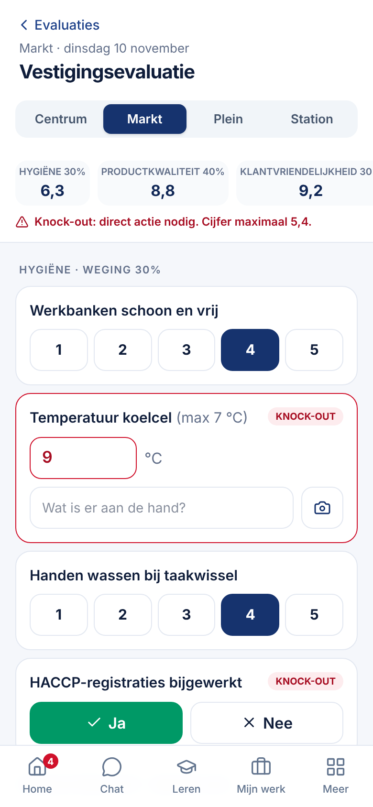

**Een evaluatie uitvoeren**

1. Loop de onderdelen **Hygiëne**, **Productkwaliteit** en **Klantvriendelijkheid** door. Geef een score van 1 tot 5, vul Ja/Nee in of noteer een meting.
2. Bovenaan zie je het cijfer per onderdeel en het **eindcijfer**, gewogen per onderdeel.
3. Vragen met het label **knock-out** zijn zo belangrijk dat het eindcijfer maximaal 5,4 wordt als ze niet in orde zijn.
4. Tik op **Afronden**.

 

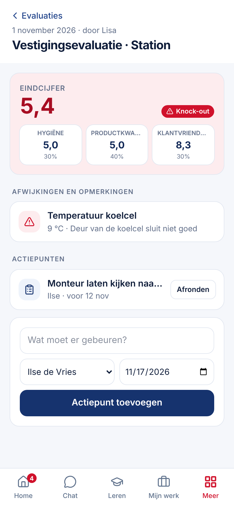

**Actiepunten opvolgen**

1. Na het afronden zie je het resultaat met alle afwijkingen.
2. Voeg bij **Actiepunten** toe wat er moet gebeuren, wie het doet en wanneer het af moet zijn.
3. De eigenaar ziet het actiepunt in *Te doen* en tikt op **Afronden** zodra het klaar is.
4. Een te laat actiepunt kleurt rood.

 

### 4. HQ (beheeromgeving)

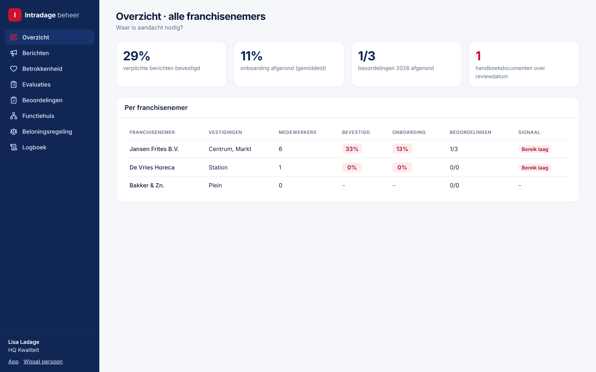

**Overzicht.** Per franchisenemer zie je hoeveel verplichte berichten zijn bevestigd, hoe ver de onboarding is en hoeveel beoordelingen zijn afgerond. Bij een rood label is er aandacht nodig.

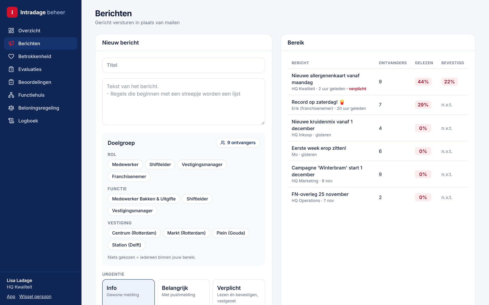

**Berichten versturen**

1. Vul een titel en de tekst in.
2. Kies de doelgroep op rol, functie en/of vestiging. Rechtsboven zie je live hoeveel ontvangers dat zijn.
3. Kies de urgentie. Een **verplicht** bericht blijft vastgezet tot het is bevestigd.
4. Rechts volg je per bericht hoeveel ontvangers het hebben gelezen en bevestigd.

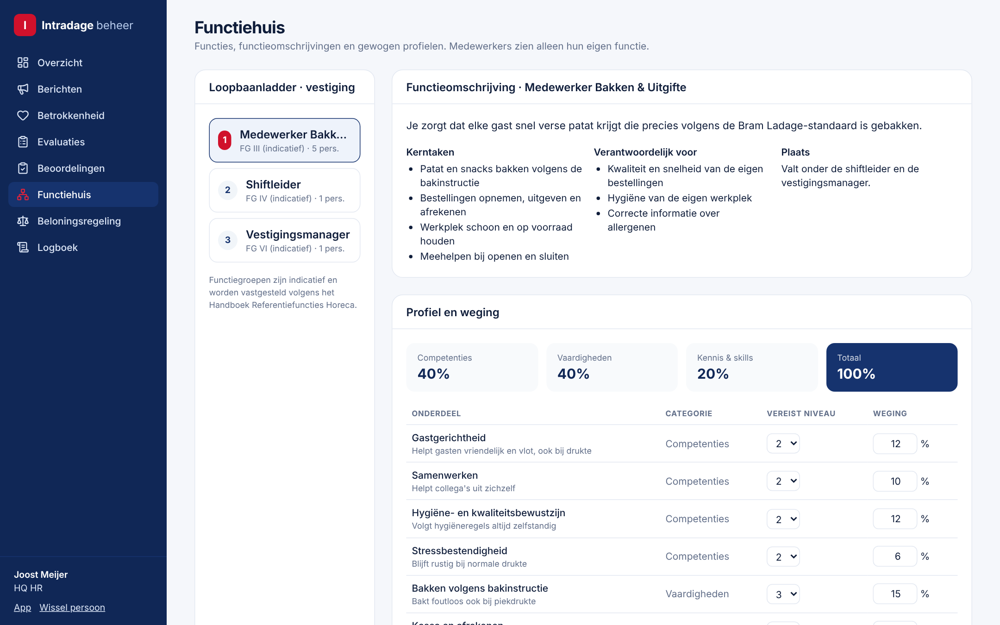

**Functiehuis (HQ).** Kies links een functie. Daarna:

- Bekijk of wijzig de functieomschrijving.
- Stel per onderdeel het vereiste niveau en de weging in.
- Opslaan kan pas als de wegingen samen precies 100% zijn.

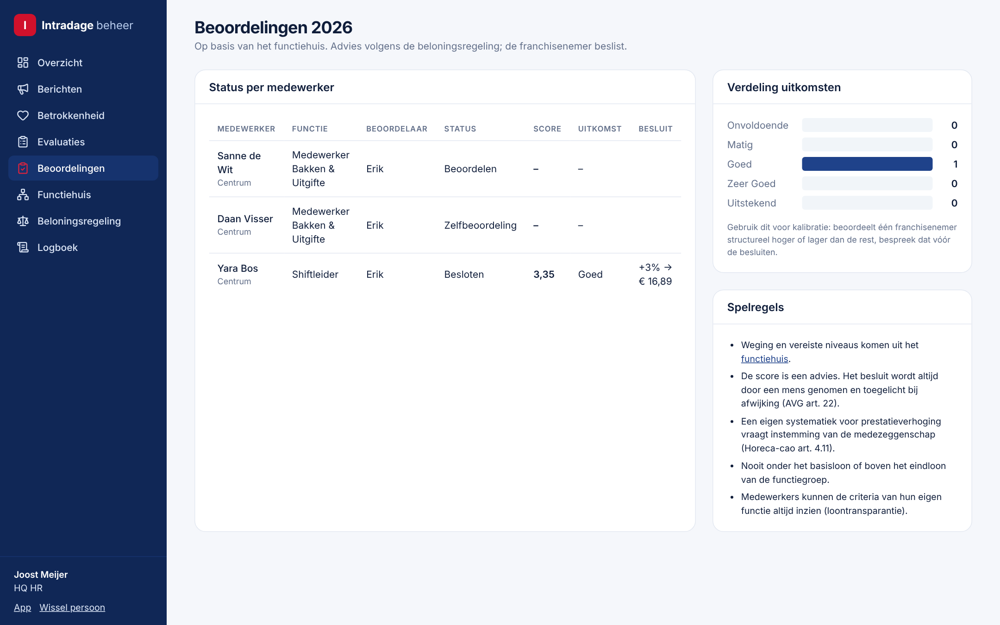

**Beoordelingen.** Hier zie je de status en uitkomst per medewerker en de verdeling van de uitkomsten. Gebruik die verdeling voor kalibratie: valt één franchisenemer structureel hoger of lager uit, bespreek dat dan vóór de besluiten. Salarisbedragen ziet alleen HQ HR.

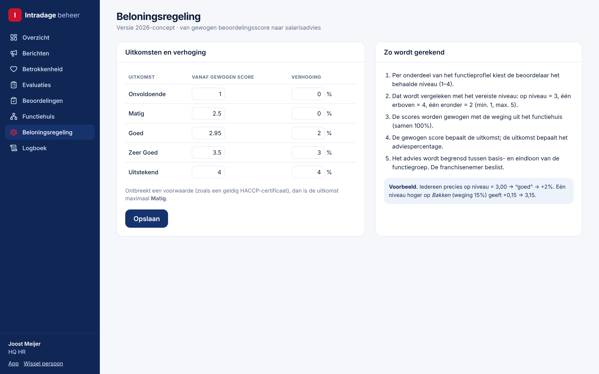

**Beloningsregeling (HQ HR).** Hier stel je de grenzen van de uitkomsten en het verhogingspercentage per uitkomst in. Een eigen regeling vraagt instemming van de OR of PVT (Horeca-cao art. 4.11).

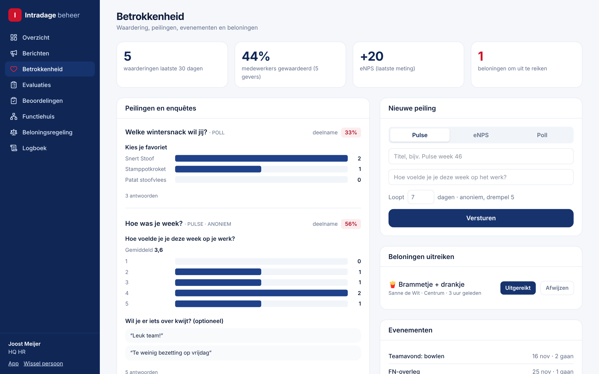

**Betrokkenheid.** Bovenaan staan het aantal waarderingen, het deel van de medewerkers dat is gewaardeerd, de laatste **eNPS** en het aantal beloningen dat nog moet worden uitgereikt.

- Onder **Peilingen en enquêtes** zie je per peiling de deelname en de resultaten. Bij anonieme peilingen zijn details pas zichtbaar vanaf 5 antwoorden.
- Met **Nieuwe peiling** start je een pulse (score 1–5), een eNPS-meting (0–10) of een poll met eigen opties. De peiling verschijnt bij iedereen in *Te doen*.
- Onder **Beloningen uitreiken** tik je op **Uitgereikt** of **Afwijzen**. Een franchisenemer ziet alleen de aanvragen van zijn eigen mensen.
- Onder **Evenementen** maak je een evenement aan. Een franchisenemer doet dat voor zijn eigen team.
- Onderaan zie je bij welke kernwaarden het vaakst wordt gewaardeerd.

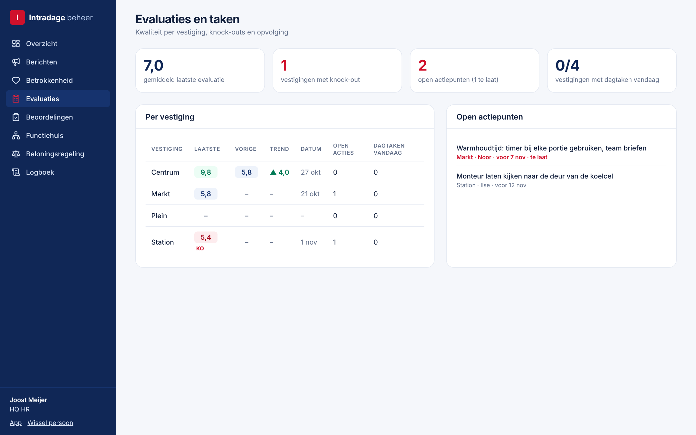

**Evaluaties.** Per vestiging zie je het laatste en vorige cijfer, de trend, knock-outs (**KO**), open actiepunten en of de dagchecklists vandaag zijn gedaan. Rechts staan alle open actiepunten; te late staan in rood. Klik op een vestiging om de evaluatie te openen.

**Logboek.** Hier staan alle beheeracties en elke inzage van gevoelige gegevens. Met **Demodata herstellen** zet je de demo terug naar de beginstand.
